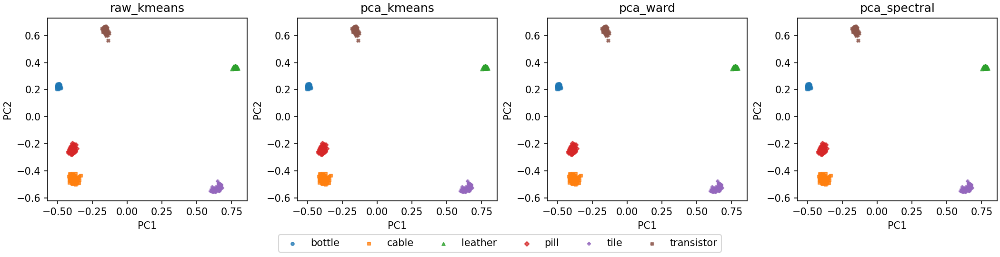

<div align="center">

<h1>🧭 Strata：图像聚类、气象预测与跨模态异常检测</h1>
<p><strong>数据挖掘导论 2026 · 四项必做 · 拓展一</strong></p>

<p>
  <a href="#quick-start"></a>
  <a href="#tasks"></a>
  <a href="#outputs"></a>
</p>

<p><a href="#tasks">实验与结果</a> · <a href="#quick-start">快速开始</a> · <a href="#layout">仓库结构</a> · <a href="#outputs">结果文件</a></p>

</div>

<a id="tasks"></a>

## 📊 实验与结果

| 作业任务 | 命令 | 实现 | 原始数据实测 |
| :--- | :--- | :--- | :--- |
| **① 图像无监督聚类** | `cluster` | 冻结 ResNet-50 多层特征，比较 K-means、Ward 和谱聚类 | 600 张图、6 类。四组实验 ARI / NMI / 匹配准确率均为 **1.000** |
| **② 图像异常检测** | `image` | 正常图块近邻、密度修正、监督 SVM 和分数融合 | 榛果图块近邻 AUROC / AP **1.000 / 1.000**。拉链密度修正 **0.990 / 0.983** |
| **③ CO₂ 时间序列预测** | `weather` | 用连续 12 点的全部 21 项指标预测下一时刻浓度，比较持久性、Ridge 和梯度提升 | 验证集选出的周期中位数模型测试 MAE **1.854 ppm**，持久性基线 **1.970 ppm** |
| **④ 甲状腺无监督疾病判断** | `thyroid` | 仅用正常数据拟合稳健缩放、近邻记忆、高斯混合和隔离森林 | 隔离森林 AUROC **0.981**。原始正常记忆 AP **0.814** |
| **✦ 拓展一 · 跨模态异常检测** | `cross-modal` | 图像与表格按域建正常样本库，共用 5 近邻评分、聚合及校准规则 | 密度修正三域等权宏 AUROC / AP **0.988 / 0.920** |

<p align="center">
  
  <br><sub>六类图像的共同 PCA 投影。颜色和形状使用评估阶段的簇匹配结果。</sub>
</p>

聚类类别只参与评价。天气按目标时间作 70% / 15% / 15% 划分，标准化只拟合训练数据，以验证 MAE 选模。异常检测以独立正常样本校准阈值，测试标签只用于评价。跨模态同时输出逐域、等权宏平均及池化结果。

<a id="quick-start"></a>

## 🚀 快速开始

**1. 安装依赖。** 使用 Python 3.11，在仓库根目录执行以下命令。

```bash
python -m pip install -r requirements.txt
python -m pip install torch==2.3.1 torchvision==0.18.1
```

**2. 放置数据。** 从课程共享获取以下四个文件并放入 `DM_2026_Dataset/`。ZIP 保持原样，程序直接读取。[📦 课程数据入口](https://bhpan.buaa.edu.cn/link/AA29E06E1DF21C419D9A1F56FFB409B665)

```text
DM_2026_Dataset/
├── Cluster.zip
├── Image_Anomaly_Detection.zip
├── weather.csv
└── thyroid.zip
```

**3. 运行实验。**

```bash
python run.py all
```

单独运行时，将 `all` 换成上表命令。用 `--data` 或 `--output` 指定输入或输出目录。

<details>
<summary>⚙️ 图像权重、独立环境与缓存</summary>

首次提取图像特征时会下载 torchvision 官方 ResNet-50 IMAGENET1K_V2 权重，支持 CUDA 与 CPU。离线时使用 `--weights /path/to/resnet50-11ad3fa6.pth`，程序校验完整 SHA-256。若 PyTorch 装在另一环境，用 `--vision-python /path/to/python` 指定其解释器。特征缓存默认位于 `.cache/`，可用 `--cache` 改路径。

</details>

<a id="layout"></a>

## 🗂️ 仓库结构

```text
.
├── run.py               # 五项实验的统一入口
├── requirements.txt     # 数值实验与绘图依赖
├── dm2026/
│   ├── vision.py        # 图像特征提取
│   ├── cluster.py       # 图像聚类
│   ├── anomaly.py       # 图像、甲状腺与跨模态异常检测
│   ├── weather.py       # 数据清洗、滑窗与 CO₂ 回归
│   ├── common.py        # 指标、曲线与结果导出
│   └── provenance.py    # 数据和权重指纹
└── assets/              # README 实验预览图
```

课程数据、报告、模型权重和完整运行产物保存在本地。

<a id="outputs"></a>

## 📁 结果文件

| 默认目录 | 主要产物 |
| :--- | :--- |
| `outputs/cluster/` | 簇分配、列联表、聚类指标和共同 PCA 投影 |
| `outputs/image/` | 逐类别样本分数、ROC / PR、混淆计数和局部异常热图 |
| `outputs/weather/` | 测试预测、训练验证测试划分、周期特征消融和大幅变化子集指标 |
| `outputs/thyroid/` | 样本级异常分数、ROC / PR、混淆计数和重复特征敏感性分析 |
| `outputs/cross-modal/` | 逐域指标、三域等权宏平均和校准分数池化结果 |

`outputs/run_all.json` 记录命令、软件版本及数据、权重和源码的 SHA-256。表中结果来自本仓库原始数据运行，软件版本差异可能影响末位数值及个别模型结果。
